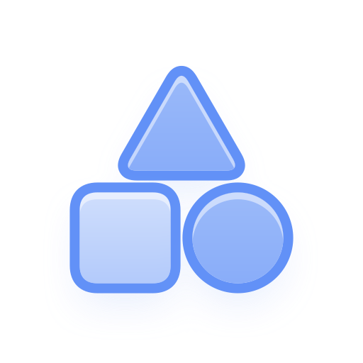
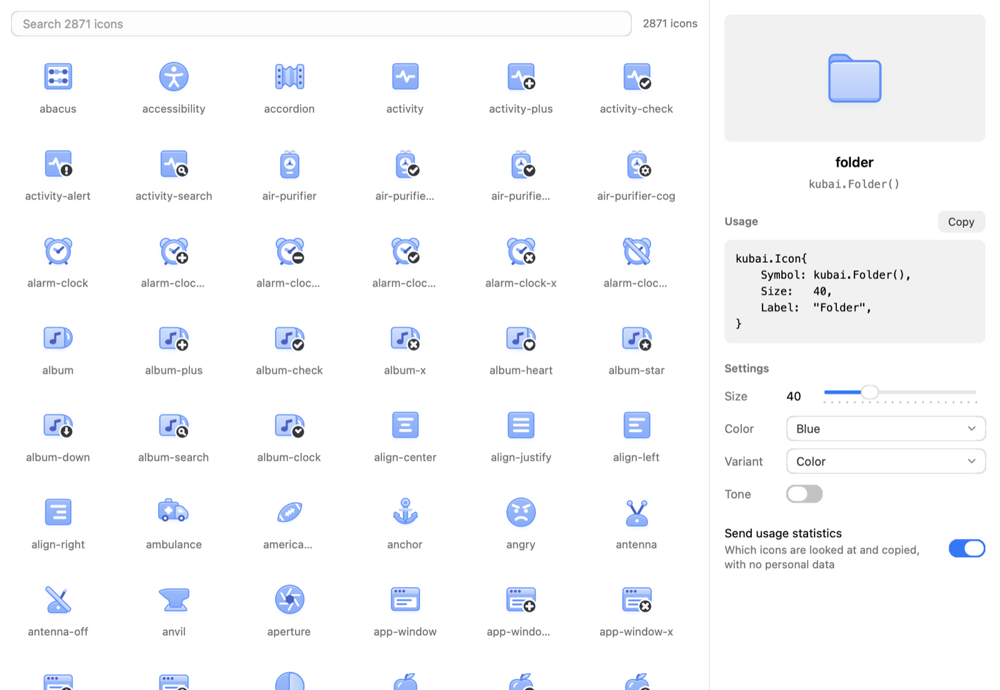

<p align="center">
  
</p>

<h1 align="center">NSGo Kubai Icons</h1>

<p align="center">
  <strong>English</strong> |
  <a href="README.zh-CN.md">简体中文</a>
</p>

<p align="center">
  <a href="https://github.com/oneo-me"></a>
  <a href="https://oneo.me"></a>
  <a href="https://x.com/oneo666"></a>
  <a href="https://github.com/sponsors/oneo-me"></a>
</p>

<p align="center">
  2,871 <a href="https://github.com/kubai087/kubai-icons">Kubai Icons</a> for <a href="https://github.com/oneo-me/nsgo">NSGo</a> apps: layered, tinted with your accent, and moving on hover, with no JavaScript at run time.
</p>

<p align="center">
  
</p>

## Install

```sh
go get github.com/oneo-me/nsgo-icons-kubai
```

Requires Go 1.26. `go get` brings the NSGo commit this library is built against.

## Usage

```go
import kubai "github.com/oneo-me/nsgo-icons-kubai"

kubai.Icon{Symbol: kubai.FolderPlus(), Size: 32, Label: "Folder plus"}
```

Each icon has an accessor named after upstream's in PascalCase (`folder-plus` is `FolderPlus`). `Icon` also takes an accent in `Color`, a `Variant` and a `BadgeColor`.

To find an icon and copy the code that draws it, run the gallery:

```sh
go tool nsgo dev examples/gallery
```

## Documentation

- [Website](https://oneo-me.github.io/nsgo-icons-kubai/)
- [Architecture](ARCHITECTURE.md): how the icons are compiled and drawn, and the usage statistics the gallery sends
- [API reference](doc.go) and [`Icon`](icon.go)

## Development

From the repository root:

```sh
go tool nsgo check
go tool nsgo test
go tool nsgo test -target macos examples/gallery
```

Regenerate the icons from a clean upstream checkout at a commit:

```sh
go run ./tools/kubaigen -upstream /path/to/kubai-icons -commit <40-character-commit>
```

See [ARCHITECTURE.md](ARCHITECTURE.md) for the layout and [AGENTS.md](AGENTS.md) for the working rules.

See [CHANGELOG.md](CHANGELOG.md) for what changed.

## License

The code is licensed under the [MIT License](LICENSE).

The icons are compiled from [Kubai Icons](https://github.com/kubai087/kubai-icons), Copyright (c) 2026 Kubai087 and the Kubai Icons contributors, under the MIT License in [LICENSE-ICONS](LICENSE-ICONS).
