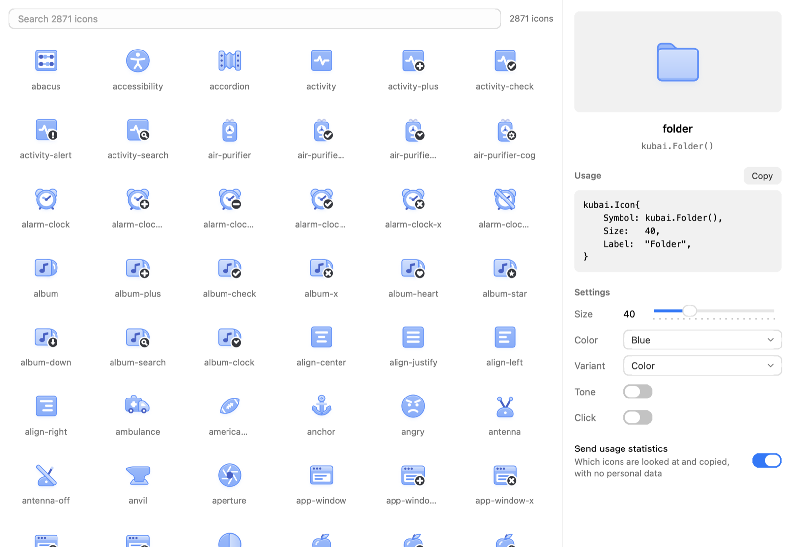

<p align="center">
  
</p>

<h1 align="center">NSGo Kubai Icons</h1>

<p align="center">
  <strong>简体中文</strong> |
  <a href="README.md">English</a>
</p>

<p align="center">
  <a href="https://github.com/oneo-me"></a>
  <a href="https://oneo.me"></a>
  <a href="https://x.com/oneo666"></a>
  <a href="https://github.com/sponsors/oneo-me"></a>
</p>

<p align="center">
  为 <a href="https://github.com/oneo-me/nsgo">NSGo</a> 应用提供的 2,871 个 <a href="https://github.com/kubai087/kubai-icons">Kubai Icons</a>：分层绘制，随强调色着色，悬停时会动，运行时不需要 JavaScript。
</p>

<p align="center">
  
</p>

## 安装

```sh
go get github.com/oneo-me/nsgo-icons-kubai
```

需要 Go 1.26。`go get` 会一并拉取本库所基于的 NSGo 提交。

## 使用

```go
import kubai "github.com/oneo-me/nsgo-icons-kubai"

kubai.Icon{Symbol: kubai.FolderPlus(), Size: 32, Label: "Folder plus"}
```

每个图标都有一个访问函数，名称是上游名称的 PascalCase 形式（`folder-plus` 即 `FolderPlus`）。`Icon` 还可以通过 `Color` 指定强调色，以及 `Variant` 和 `BadgeColor`。设置 `Click` 可在点击时播放一次动画。

要查找图标并复制绘制它的代码，运行 gallery：

```sh
go tool nsgo dev examples/gallery
```

## 文档

- [网站](https://oneo-me.github.io/nsgo-icons-kubai/zh/)
- [架构](ARCHITECTURE.md)：图标如何编译和绘制，以及 gallery 发送的使用统计
- [API 参考](doc.go)与 [`Icon`](icon.go)

## 开发

在仓库根目录运行：

```sh
go tool nsgo check
go tool nsgo test
go tool nsgo test -target macos examples/gallery
```

从某个提交的干净上游检出重新生成图标：

```sh
go run ./tools/kubaigen -upstream /path/to/kubai-icons -commit <40-character-commit>
```

目录结构见 [ARCHITECTURE.md](ARCHITECTURE.md)，协作规则见 [AGENTS.md](AGENTS.md)。

变更见 [CHANGELOG.md](CHANGELOG.md)。

## 许可证

代码采用 [MIT 许可证](LICENSE)。

图标编译自 [Kubai Icons](https://github.com/kubai087/kubai-icons)，Copyright (c) 2026 Kubai087 and the Kubai Icons contributors，采用 [LICENSE-ICONS](LICENSE-ICONS) 中的 MIT 许可证。
